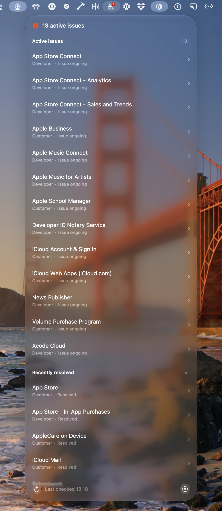

# StatusBuddy

StatusBuddy shows the status of Apple services in your Mac’s menu bar. It brings together Apple’s developer and customer system status dashboards, so you can check services such as App Store Connect, TestFlight, iCloud, and Apple Music in one place.

An exclamation mark appears on the menu bar icon when Apple reports an active issue. Click the icon to see which services are affected, check scheduled maintenance, or review recently resolved issues. Expand an active issue to read Apple’s report and choose **Notify when restored** to get a notification when the service is back online.

## Download

StatusBuddy 3.0 requires macOS Tahoe 26 or later.

- [Download StatusBuddy on Gumroad](https://statusbuddy.app). It’s free, with an optional contribution to support development.
- [Join the StatusBuddy beta on TestFlight](https://testflight.apple.com/join/MK6zSKdG). Open the invitation on your Mac with the TestFlight app installed.
